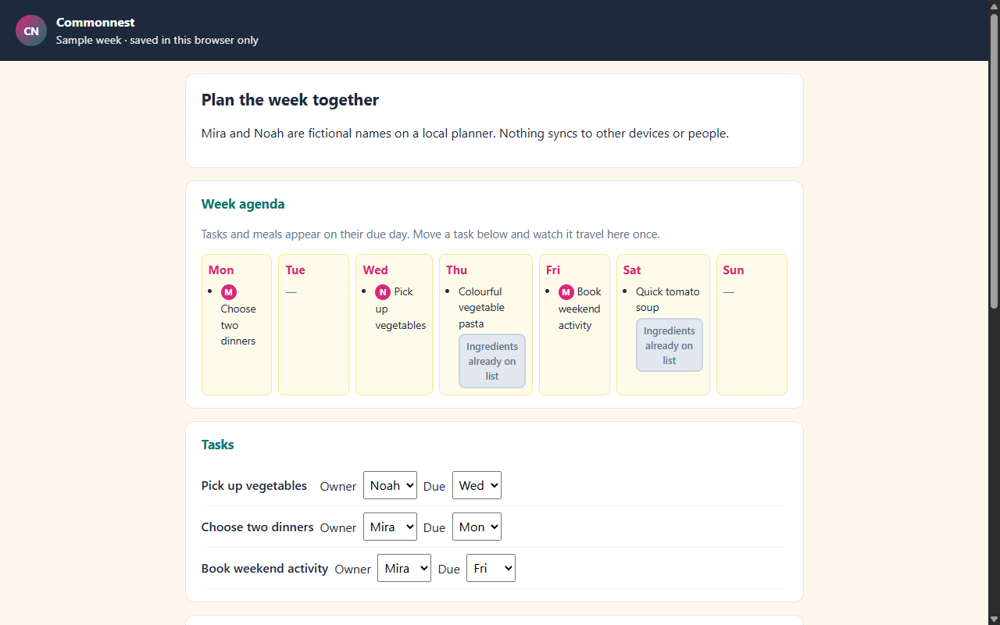
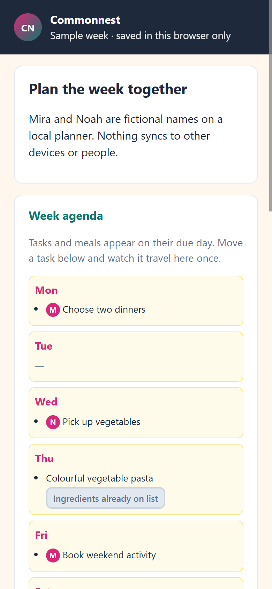

# Commonnest (independent exercise)

Original browser demo for a **fictional one-week plan** with two named owners, movable tasks, meal scheduling, and a shopping list that sums compatible ingredient units. Not a recovered historical product.

**Live demo:** https://erfanpj.github.io/commonnest-showcase/





## Problem

Shared shopping should add whole quantities when you include each scheduled meal, without counting the same meal twice. Pantry amounts in different units stay on separate lines. Checking an item off should reopen if a new meal changes the total.

## One-minute walkthrough

1. Read the banner: progress stays in this browser only.
2. Move a task’s due day and confirm it appears once on that day in the week agenda.
3. Schedule another night for a recipe, then **Add ingredients to list** (already-added meals show a disabled state).
4. Check off tomatoes in grams, add another tomato-based meal, and read the reopen note.
5. Notice pantry tomatoes in kilograms with an explanation beside that line.
6. Reload to confirm persistence; **Reset this week** restores the sample plan.

## Tests

```bash
npm test
npm run verify:demo
npm run capture:evidence
```

Verification uses a dynamic loopback port and the future Pages root `/commonnest-showcase/`.

## Engineering decision

**Shopping totals derive only from meals you explicitly add to the list**, so scheduling alone does not silently change checked quantities.

## Limitation

No multi-user sync, unit conversion, or real household data.

## Local preview

Serve a parent directory so the entry URL ends with `/commonnest-showcase/` and loads `index.html` at that root.
